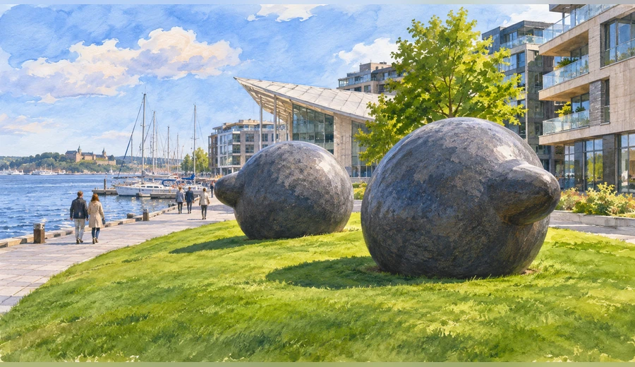
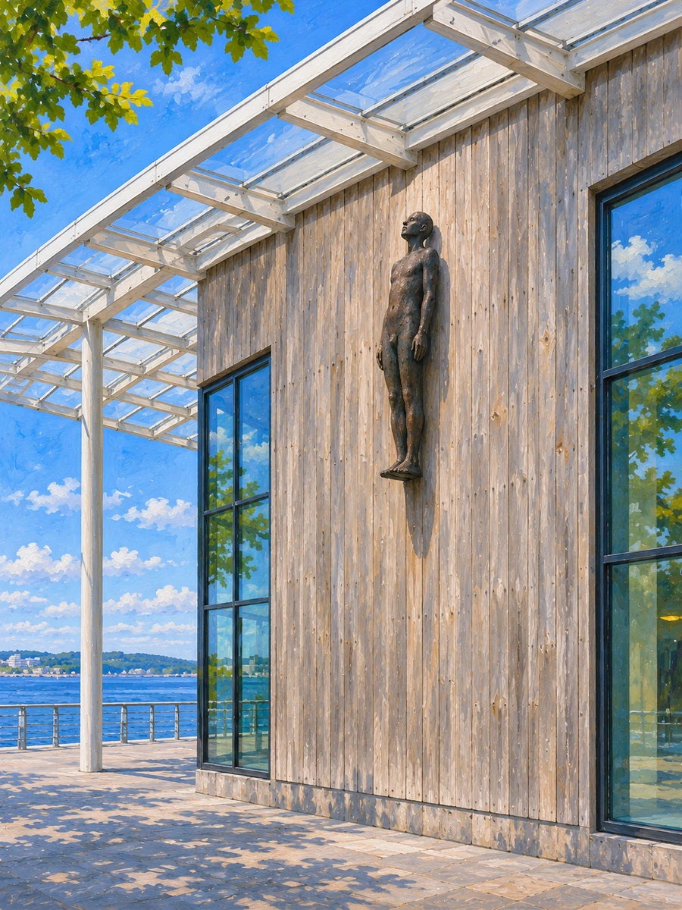
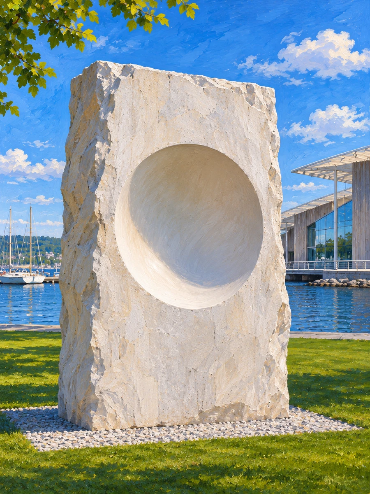
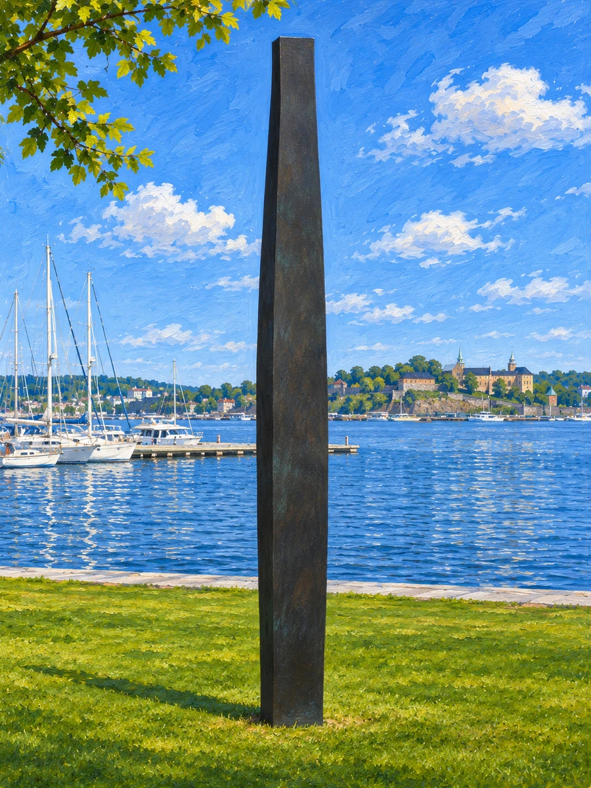
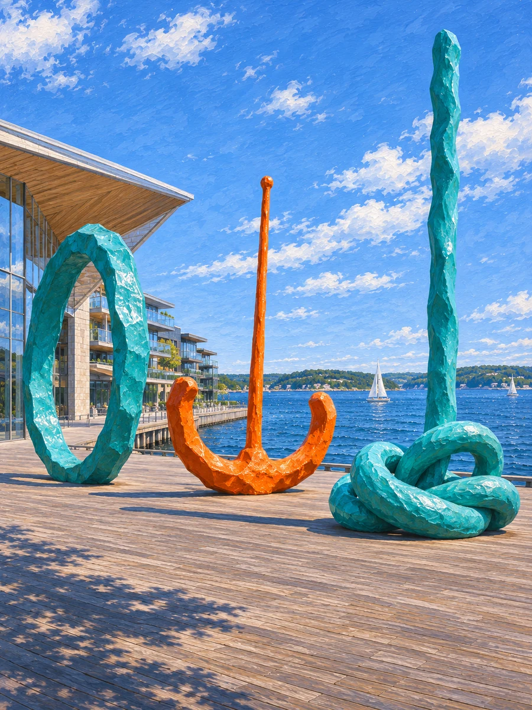
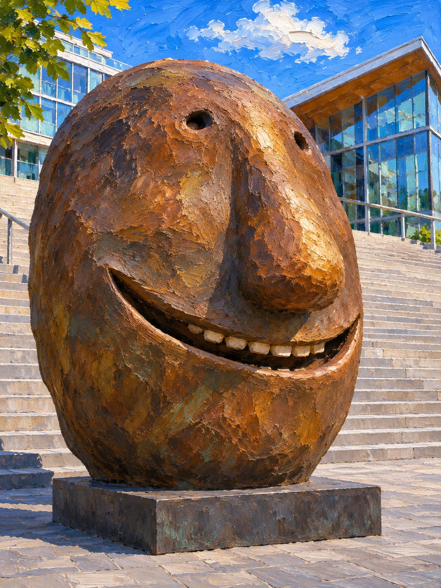
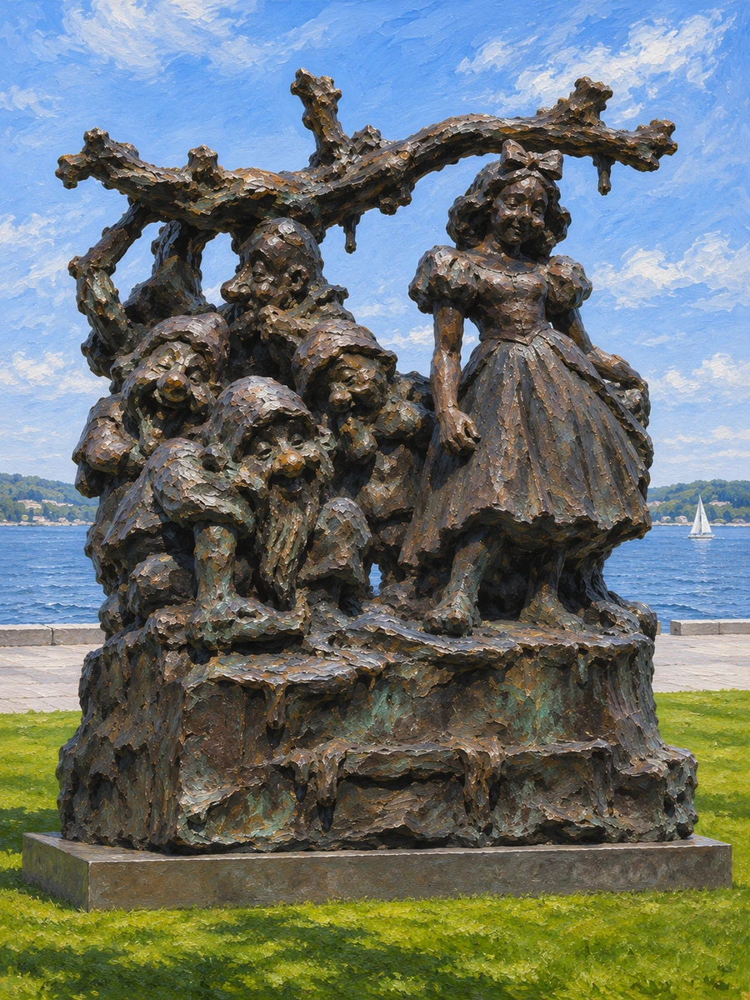
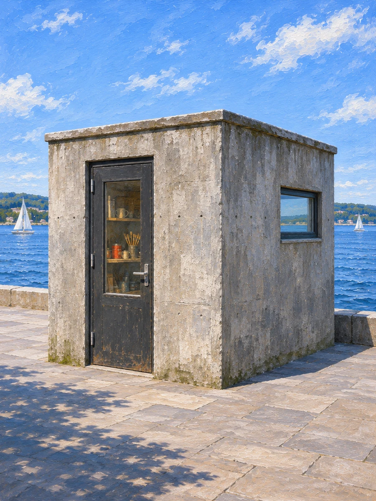

# Tjuvholmen – illustrasjonskandidater

> **Alle åtte bilder er AI-genererte illustrasjoner, ikke autentiske fotografier.** Denne mappen er et *inaktivt kandidatarkiv*. Ingen av filene er koblet til publiserte Objects eller PlaceCard. Individuell vurdering av rettigheter til avbildning av hvert kunstverk og endelig bilde-QA gjenstår.

Verk og eierforhold: [Astrup Fearnley Museet](https://www.afmuseet.no/tjuvholmen-skulpturpark/). Visuelle originalreferanser: [Tjuvholmen skulpturpark](https://www.tjuvholmenskulptur.no/).

| Illustrasjon | Kunstverk | Kontrollstatus |
|---|---|---|
|  | **Eyes** (1997) – Louise Bourgeois | Detaljkontroll gjenstår |
|  | **Edge II** (2000) – Antony Gormley | Detaljkontroll gjenstår |
|  | **Untitled** (1997) – Anish Kapoor | Detaljkontroll gjenstår |
|  | **Untitled (Totem)** (1998) – Ellsworth Kelly | Detaljkontroll gjenstår |
|  | **Spalt** (2003) – Franz West | Detaljkontroll gjenstår |
|  | **MOONRISE. east. November.** (2006) – Ugo Rondinone | **Må korrigeres før godkjenning** |
|  | **White Snow Cake** (2011) – Paul McCarthy | **Må korrigeres før godkjenning** |
|  | **Things for a House on an Island** (2005) – Peter Fischli & David Weiss | Detaljkontroll gjenstår |

## Hva gjenstår før aktivering

- Rett konkrete avvik i **MOONRISE** (materialfarge, nese og ansiktsproporsjoner) og **White Snow Cake** (figurgruppen og plattformen).
- Kontroller øvrige seks illustrasjoner mot dokumenterte originalverk; små detaljavvik må ikke presenteres som autentiske fotografier.
- Avklar relevant rettslig grunnlag for gjengivelsen av **selve kunstverket**, selv når illustrasjonen er originalgenerert.
- Behold aktive bildebaner uendret inntil eksplisitt godkjenning; ved integrasjon merk «Illustrasjon» og kjør bare direkte relevante tester.
- Bilder lagret som WebP; fulloppløste PNG-originaler ligger i prosjektbiblioteket `/History-Go/Tjuvholmen/` og `/History-Go/Tjuvholmen/Kunstverk-illustrasjoner/`.
