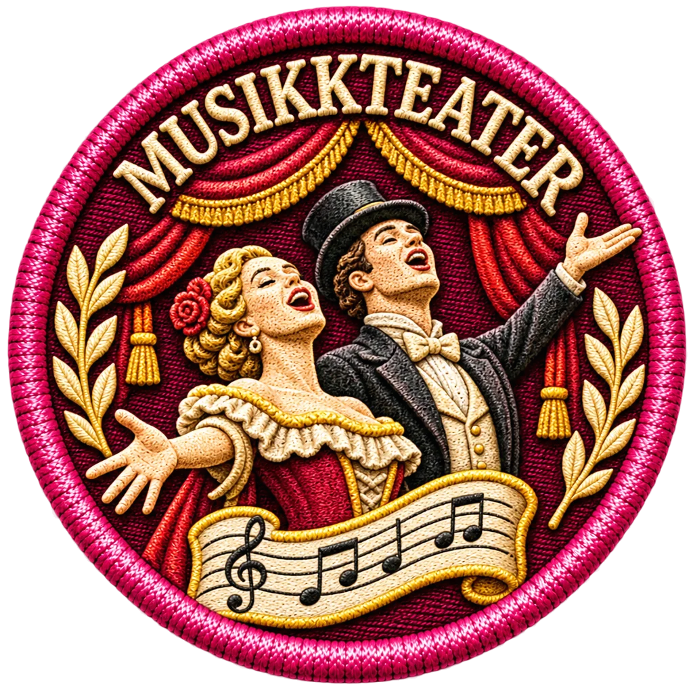

# Musikkteater – brodert undermerke v2
Dato: 2. november 2026

## Produksjon
- Ny WebP-kandidat: `bilder/merker/scenekunst/undermerker/musikkteater-brodert-v2.webp`
- 1024 × 1024, RGBA WebP, 373 504 byte, SHA-256 `d8d92228e56b6597090eb8050c1467f029cfea46ec34ebb65ef6487b5b39890c`
- Tittelen **MUSIKKTEATER** er brodert innenfor den øvre sirkulære kanten.
- Motivet skiller seg fra Scenekunst-hovedmerket: to sangere, teaterteppe og notelinje.
- Fargekrav for Scenekunst: roserosa `#C96E8B` og grå `#808080`.

## Visuell status
**Inaktiv kandidat – ikke godkjent.** Bildet viser fortsatt mye gull og mørkerødt, og må vurderes før eventuell aktivering. Det gamle `musikkteater-brodert-v1.webp` forblir avvist; ingen filer er overskrevet.

Registret `data/badges/scenekunst.json` er ikke endret, og det er ikke lagt inn noen `subBadgeImages.musikkteater`. Tidligere godkjente Dans, Performance, Sceneproduksjon, Regi og Dramaturgi beholdes.

## Teknisk test
`node --test tests/badge-musikkteater-v2-candidate.test.mjs`

Et bestått teknisk resultat betyr ikke at merkets farger eller komposisjon er visuelt godkjent.

## Ferdigstilt 2. november 2026
Musikkteater v3 er en fargejustert WebP med realistisk broderi. Gule/gylne dekordetaljer er redusert til grå trådtoner; registrert fargepar er roserosa `#C96E8B` / grå `#808080`. Den opprinnelige v2 bevares for sporbarhet.

- Ny aktiv fil: `bilder/merker/scenekunst/undermerker/musikkteater-brodert-v3.webp`
- Oppløsning: 1024 × 1024 WebP, alfa
- Filstørrelse: 390 198 byte
- SHA-256: `af61d254d71bc8bf5c29609c8839c352553c9b2b79973e48d1cbd8e72e0ab650`
- Inne i merket står **MUSIKKTEATER** i brodert bue. To sangere med notelinje gjør motivet forskjellig fra hovedmerket.
- Aktiv kobling: `data/badges/scenekunst.json -> subBadgeImages.musikkteater`.
