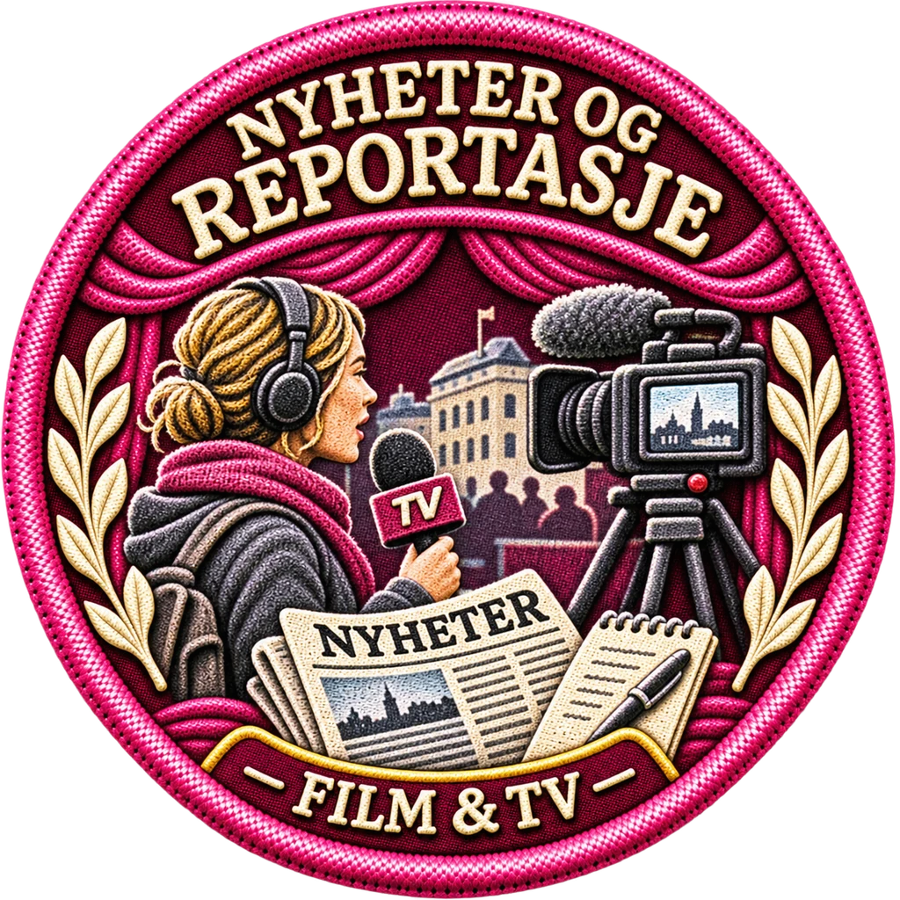

# Nyheter og reportasje – brodert undermerke v1
2. november 2026

## Status
**Ferdig som individuelt merket WebP og aktivert i produksjonsgrenen**, forbeholdt målrettet QA og merge.

- `bilder/merker/film_tv/undermerker/nyheter_og_reportasje-brodert-v1.webp`
- 1024 × 1024 WebP med alfa, **477 942 byte**
- SHA-256: `19ba49acb138e57c8b219b1a13ecdfad232c9df552555122486f8ab607299a65`

## Design
- **NYHETER OG REPORTASJE**: korrekt norsk tekst, to buede linjer i øvre innerkant.
- **FILM & TV**: mindre brodert tekst langs nedre innerkant.
- Primærfarge magenta `#C2188B`, sekundærfarge liljehvit `#E7F8FF`.
- Motivet viser en reporter i et urbant hendelsesmiljø med opptaksutstyr, publikum og diskret presseinnslag; dette er forskjellig fra TV-serier og dokumentarintervju.
- Stoff-/broderitekstur kontrollert i 1024 px og nedskalert 64 px.
- De tre tidligere feilaktige TV-SERIER-utkastene er forkastet, og ingen slike er aktivert.

## Integrasjon
`subBadgeImages.nyheter_og_reportasje` peker til den nye WebP-filen i `data/badges/film_tv.json`. Filens mål, SHA-256 og visuelle godkjenning er registrert i `data/badges/underbadge_batch01_production.json`.

De fire eksisterende Film & TV-undermerkene og sju aktive Scenekunst-undermerker er bevart. Ingen hovedmerker er byttet ut.

## Test
`node --test tests/badge-nyheter-reportasje-v1-production.test.mjs tests/badge-underbadge-batch01.test.mjs`

## Videre
Neste undermerke er `klassikere` (filmklassikere), med egen brodert komposisjon og **FILM & TV** nederst.
