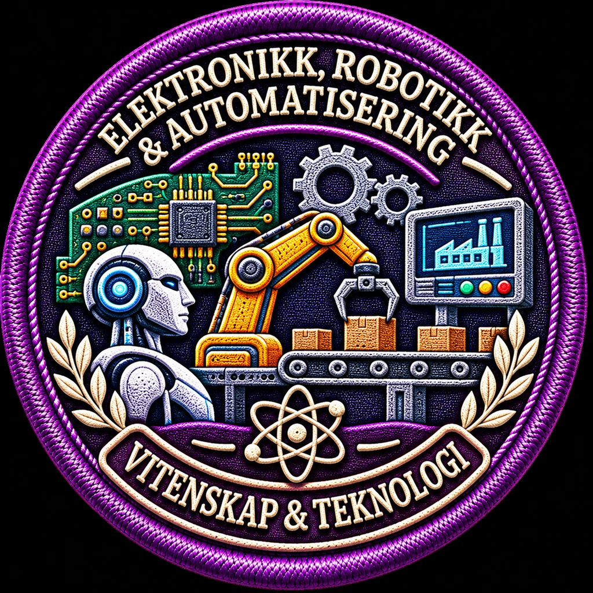

# History Go – godkjent visuell stil for Vitenskap & teknologi

**Vedtak 11. november 2026:** Den detaljerte broderistilen fra illustrasjonen «Elektronikk, robotikk og automatisering» er valgt som **felles designreferanse for alle 16 Vitenskap & teknologi-undermerker**, både nye produksjoner og revisjoner av tidligere merker.

> Dette WebP-bildet er en **stilreferanse**, ikke en aktiv produksjonsfil. Bildet har hvit bakgrunn og bruker «&» i øvre motivtekst; ferdig norsk produksjonsmerke må bruke kanonisk underkategorinavn med **«OG»**, samt transparent utside.

## Felles visuelle kjennetegn

- **Rundt stoffmerke** med markert, tett sydd lilla ytterkant, flettet/sydd indre kant og naturtro trådrelieff.
- **Kategorifarge #6A5AE0** er seriens gjennomgående farge. Mørk marineblå/lilla tekstilbunn; detaljer i krem, gull, hvitt og farger tilpasset hvert fagmotiv.
- **Rikt og særpreget midtmotiv** med gjenkjennelige faglige gjenstander, bygninger, instrumenter eller scener. Robotikk kan ha robot, fabrikk og kretskort; astronomi får egne motiver. Motivene skal **ikke kopieres** på tvers av emnene.
- **Opphøyd, tydelig brodert øvre tittel** med underkategorinavn og korrekt språk. Lange navn kan fordeles på to buer.
- **Nedre buet bånd med hele hovedkategorinavnet**, brodert som synlig tekst: **VITENSKAP & TEKNOLOGI**. Navnet skal alltid stå **nederst på selve merket**, ikke bare i UI eller manifest.
- Laurel-/laurbærmotiv og et diskret atom-symbol kan brukes som konsistent identitetsmarkør; de skal aldri erstatte nedre kategorinavn.
- Tilstrekkelig kontrast til at tekst og motiv kan identifiseres i liten mobilstørrelse. Ingen prosent-, poeng- eller fraksjonsnummer på bildene.

## Språk og leveransekrav

- Norsk original og inaktive varianter på engelsk, spansk, portugisisk og fransk; motiv og oppbygging er de samme i alle språk.
- **Begge tekstfeltene oversettes**. Norsk nedre tekst er «VITENSKAP & TEKNOLOGI»; andre språk får det fullstendige oversatte hovedkategorinavnet, ikke en forkortelse.
- Hvert produksjonsmerke: **1024 × 1024 WebP med alfakanal og transparent utside**, originalillustrasjon; aldri bilde av en hel nettside, kontaktark eller statusrapport.
- Før aktivering: visuell godkjenning av øvre/nedre tekst og motiv, riktig kategori-ID, verifisert SHA-256/Git-blob-hash og målrettet CI.
- Bevar History Go-hovedlogo, Vitenskap-hovedmerke og alle gjeldende godkjente bildefiler uendret **inntil** en korrekt, kontrollert erstatning er laget. Den nye stilen gjelder også disse som revisjonsmål, men dokumentvedtaket er ikke en automatisk masseutskifting.

## Oppdatert produksjonsstatus – 12. november 2026

- **16 av 16** Vitenskap-undermerker er registrert i `data/badges/vitenskap.json`, med norske originaler; de ni nyere merkene er produsert i den godkjente, detaljrike broderistilen.
- **Sju eldre merkeillustrasjoner må oppgraderes enkeltvis:** Naturvitenskap, Teknologi, Informasjonsteknologi, Matematikk, Forskning og metode, Astronomi og fysikk, Kjemi og materialvitenskap.
- Det er verifisert at alle sju eldre bildene har en enkel symbolkomposisjon på lys bunn og **mangler den obligatoriske nedre teksten «VITENSKAP & TEKNOLOGI»**.
- De sju eksisterende originalene og SHA-ene er låst for etterprøvbar revisjon i `data/badges/vitenskap_legacy_illustration_review_20261112.json`. **Ingen av originalene erstattes før et nytt enkelt, rundt merke er visuelt kontrollert**, med fem språkvarianter, korrekt underkategoritittel øverst og fullt kategorinavn nederst.
- En poster, statusgrafikk, et kontaktark eller utsnitt av et helt galleri er **ikke** en gyldig produksjonsfil. Feilaktige bildegenereringer skal forkastes; bildet må være ett enkelt brodert merke i kvadratisk 1024 × 1024 WebP med transparent utside.
- **Første kandidat i revisjonsrekkefølgen er Naturvitenskap.** Den skal vise flere naturvitenskapelige grener (botanikk, dyreliv, geologi og laboratorieforskning), ikke bare én laboratoriekolbe.
- GitHub Pages publiserte sluttversjonen av 16-merkeserien fra commit `092db11a9ae807e9d4c638514e854d35817aca5a` med `success`.

Denne stilstandarden utfyller [undermerke-typografi-standard.md](undermerke-typografi-standard.md).
